# 计算机图形学课程作业一 光栅化器

姓名：________　学号：________

## 一、概述

这次作业沿用提供的 SVG 渲染器，补上三角形光栅化、超采样反走样、二维几何变换和重心坐标插值，并实现最近邻、双线性纹理采样及 MipMap 层级采样。SVG 解析后，先将图元变换到屏幕坐标，再计算各采样点的颜色，写入采样缓冲区。绘制结束后，将同一像素的样本求平均，得到输出图像。

实现沿用模板的接口和渲染流程，补全采样、变换和插值部分，同时修复了 MipMap 漏生成最后一层的问题。

除重心坐标示意图为 600 × 600 外，报告配图均由程序的截图功能输出，分辨率为 1600 × 1200。

## 二、绘制三角形

先根据三个顶点求轴对齐包围盒。左边界和上边界向下取整，右边界和下边界向上取整，再裁剪到屏幕范围。这样只需要遍历包围盒内的像素。每像素采样一次时，像素 $(x,y)$ 的采样点放在中心 $(x+0.5,y+0.5)$。

设三角形顶点为 $A,B,C$，采样点为 $P$。二维叉积定义为

$$
\operatorname{cross}(U,V)=U_xV_y-U_yV_x.
$$

用 $D=\operatorname{cross}(B-A,C-A)$ 表示有向面积的两倍，计算三个权重

$$
\alpha=\frac{\operatorname{cross}(B-P,C-P)}{D},\qquad
\beta=\frac{\operatorname{cross}(C-P,A-P)}{D},\qquad
\gamma=\frac{\operatorname{cross}(A-P,B-P)}{D}.
$$

三个权重都不小于零时，采样点位于三角形内，边界上的点也算覆盖。顶点顺序反转后，分子和分母一起变号，权重不变，因此顺时针和逆时针排列都能绘制。单色三角形复用颜色插值三角形的流程，把三个顶点设成同一种颜色即可。

下图是三角形示例在默认视角、每像素采样一次时的结果。

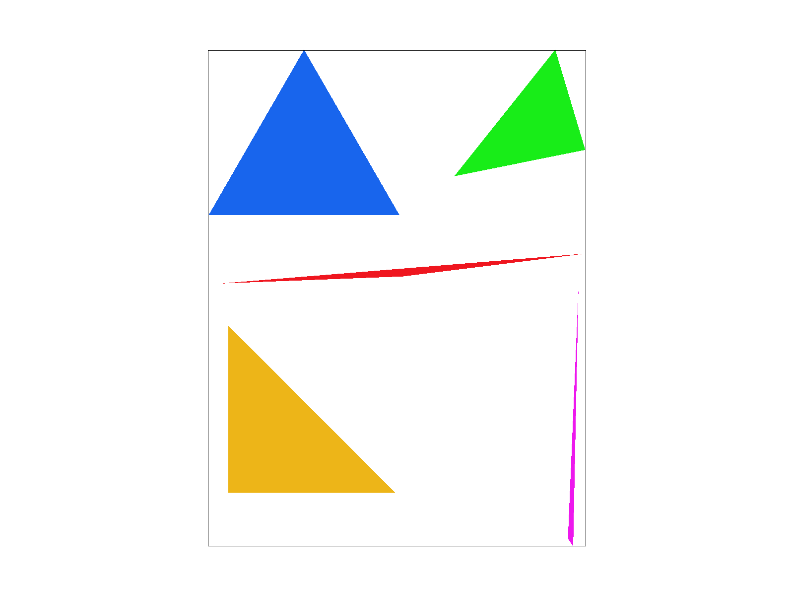

把像素检查器放在红色细三角形靠近右侧尖端的位置，可以看到边缘的阶梯和尖端附近的间断。

实现中将面积倒数和采样间距放在循环外计算，输出图像时按行访问采样缓冲区，减少重复计算并保持连续的内存访问。

## 三、基于超采样的反走样算法

设每个像素采样 $S$ 次，令 $n=\sqrt{S}$，在像素内放置 $n\times n$ 个样本。每个样本位于对应子像素的中心。

$$
P_{ij}=\left(x+\frac{i+0.5}{n},\ y+\frac{j+0.5}{n}\right),
\qquad 0\le i,j<n.
$$

所有样本存入同一个采样缓冲区。同一像素的样本连续存放，像素之间按行排列。若画布宽、高分别为 $W_s,H_s$，缓冲区共存放 $W_sH_sS$ 个颜色样本。

三角形只覆盖像素的一部分时，只更新落在三角形内的样本。其余样本保留之前的颜色，可能来自前面绘制的图元，也可能是白色背景。

画布尺寸或采样率改变时，重新调整缓冲区长度。每帧绘制前，将所有样本重置为白色。单色、渐变色和纹理三角形都在子像素网格上采样，点和线则将一个像素内的全部样本写成同一颜色。这次没有对点和线单独做反走样。

所有图元绘制完后，对每个像素的 $S$ 个样本求平均。

$$
C_{\text{pixel}}=\frac{1}{S}\sum_{k=0}^{S-1}C_k.
$$

RGB 分量乘以 255，四舍五入后转成 8 位整数，写入帧缓冲区。

下面三张图使用前面的三角形示例，视角和像素检查器位置相同。1、4、16 表示每个输出像素的采样次数。

| 1 次采样，1 × 1 网格 | 4 次采样，2 × 2 网格 | 16 次采样，4 × 4 网格 |
| --- | --- | --- |
|  |  | 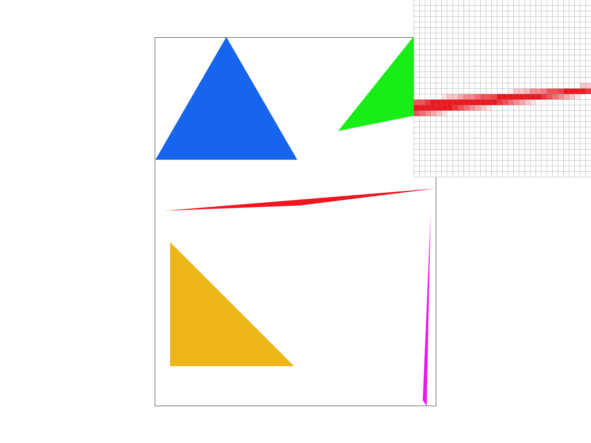 |

只采样一次时，一个像素要么画成红色，要么保留背景色。细三角形的尖端容易错过采样点，出现间断。采样四次后，边缘开始出现浅红色像素。采样十六次后，覆盖比例分得更细，尖端更连续，边缘的颜色变化也更平缓。这里的浅红色就是红色样本和白色背景求平均的结果，没有使用透明度混合。

超采样用多个点近似像素区域内的颜色平均，能反映部分覆盖的情况。样本数量仍然有限，所以极细的图元和高频纹理还可能走样。

每个样本用三个单精度浮点数记录 RGB 分量，共占 12 字节。在 1600 × 1200 分辨率下，采样缓冲区的存储量如下。表中只计算实际样本，不包含纹理、帧缓冲区和缓冲区预留的容量。

| 每像素采样次数 | 样本数量 | 存储量 |
| --- | --- | --- |
| 1 | 1,920,000 | 约 21.97 MiB |
| 4 | 7,680,000 | 约 87.89 MiB |
| 16 | 30,720,000 | 约 351.56 MiB |

如果只保存每个像素的平均颜色，后续图元覆盖部分样本时，就无法恢复这些样本原来的颜色。要减少缓冲区，可以按像素或小块处理图元，算完后立即求平均。这样需要重新组织图元遍历，还要保持绘制顺序。这次保留了完整的采样缓冲区。

## 四、几何变换

二维点用列向量 $(x,y,1)^T$ 表示。平移、缩放和旋转矩阵如下。

$$
T=\begin{bmatrix}1&0&d_x\\0&1&d_y\\0&0&1\end{bmatrix},\qquad
S=\begin{bmatrix}s_x&0&0\\0&s_y&0\\0&0&1\end{bmatrix},
$$

$$
R=\begin{bmatrix}\cos\theta&-\sin\theta&0\\\sin\theta&\cos\theta&0\\0&0&1\end{bmatrix},
\qquad \theta=\text{deg}\cdot\frac{\pi}{180}.
$$

旋转角度以度为单位输入，计算三角函数前先换成弧度。SVG 的纵轴向下，向右伸出的手臂使用负角度旋转后，会在画面上抬起来。

在提供的机器人模型上调整动作，得到[抬手姿势的模型](docs/my_robot.svg)。画面右侧的上臂旋转 -45°，前臂在子组中再旋转 -65°，做出抬手的姿势。两条腿分别旋转 12° 和 -12°，站得稍微分开一些。左侧手臂保持水平。

右侧前臂的矩阵链为

$$
T(250,250)\,T(90,-40)\,R(-45^\circ)\,T(70,0)\,R(-65^\circ)\,S(0.6,0.2).
$$

矩阵从右向左作用。前臂先在局部坐标里缩放、旋转，再移动到上臂的位置，随后跟随父组旋转和平移。因此改动上臂所在的父组时，前臂也会一起运动。

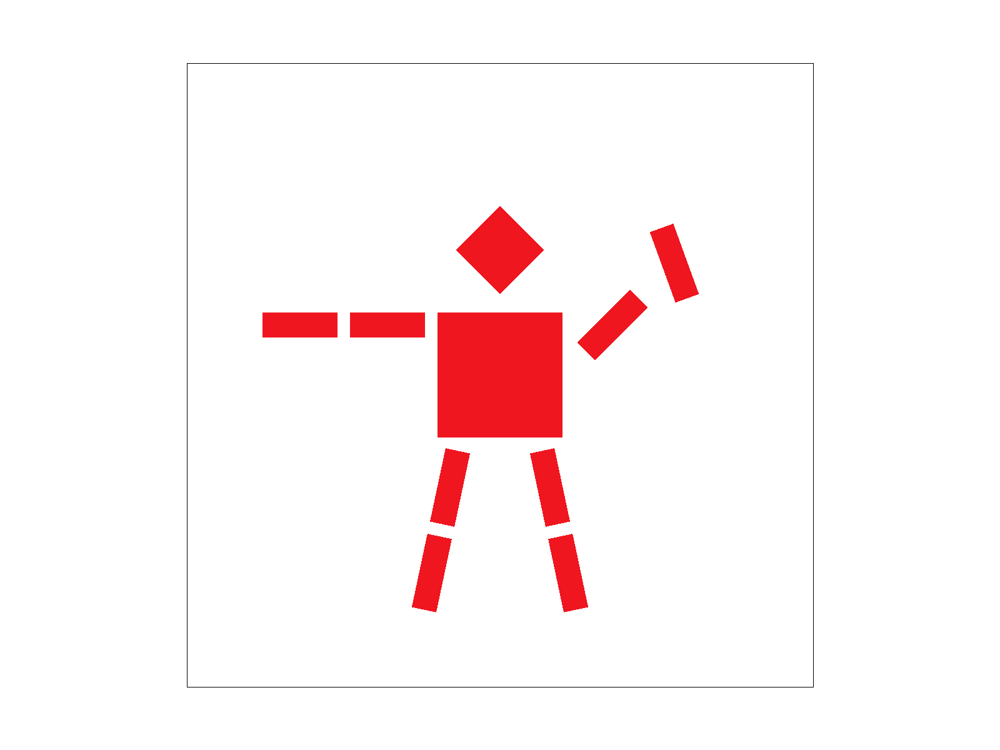

## 五、质心坐标

重心坐标把三角形内的点写成三个顶点的加权组合。

$$
P=\alpha A+\beta B+\gamma C,\qquad \alpha+\beta+\gamma=1.
$$

在顶点 $A$ 处，权重是 $(1,0,0)$。在边 $BC$ 上，$\alpha=0$。到了三角形重心，三个权重都是 $1/3$。前面用这些权重判断覆盖关系，这里用它们插值顶点颜色。

设三个顶点的颜色为 $C_0,C_1,C_2$，采样点的颜色为

$$
C(P)=\alpha C_0+\beta C_1+\gamma C_2.
$$

每个子采样点都先计算权重，再将插值颜色写入缓冲区。下面的[顶点颜色示例](docs/colors.svg)中，上方顶点为红色，左下为绿色，右下为蓝色。越靠近哪个顶点，颜色就越接近那个顶点的颜色，中间区域由三种颜色混合。

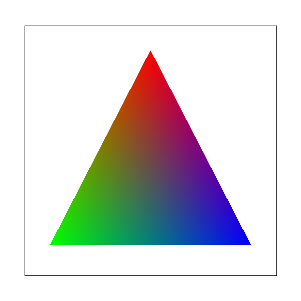

下图是色轮示例的默认视角，每像素采样一次。色轮外围的颜色连续变化，各个三角形向黑色中心过渡，共享边附近没有明显的颜色断层。

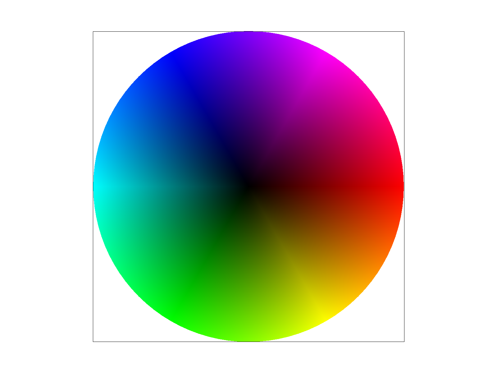

## 六、基于像素采样的纹理映射

屏幕采样点对应的 UV 坐标由三个顶点插值得到。

$$
\operatorname{uv}(P)=\alpha\operatorname{uv}_0+
\beta\operatorname{uv}_1+\gamma\operatorname{uv}_2.
$$

UV 通常落在纹素之间，需要根据所选的采样方法确定颜色。

最近邻采样将 UV 分量分别乘以纹理的宽、高，再向下取整，读取对应纹素。纹理边缘的坐标限制在有效纹素范围内。每次只读一个纹素，计算量少，放大后能看到色块。

双线性采样使用 $x=uW-0.5$、$y=vH-0.5$，让整数坐标对应纹素中心，边界处沿用边缘纹素的颜色。设坐标的小数部分为 $s,t$，周围四个纹素为 $C_{00},C_{10},C_{01},C_{11}$，插值结果为

$$
C=(1-t)\big((1-s)C_{00}+sC_{10}\big)
 +t\big((1-s)C_{01}+sC_{11}\big).
$$

插值时先沿水平方向计算两行的颜色，再沿竖直方向混合。

使用钟楼纹理进行对比。将视图放大，像素检查器放在窗框附近。四张图保持相同视角，均从原始纹理层采样，只改变像素采样方法和采样次数。

| 每像素采样次数 | 最近邻采样 | 双线性采样 |
| --- | --- | --- |
| 1 |  | 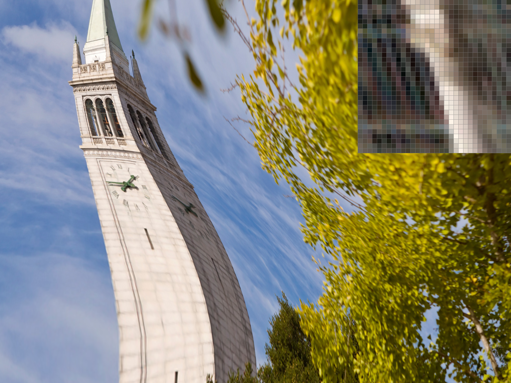 |
| 16 |  |  |

最近邻采样一次时，窗框的亮暗边缘有块状跳变，树叶细节也比较碎。换成双线性后，窗框边缘过渡平缓了一些，纹理更连贯，细节也变软了。最近邻跨过纹素边界时会直接换颜色，双线性则在相邻纹素之间插值，这种差别在放大的窗框上容易看出来。

每像素采样十六次时，会查询多个 UV 位置再求平均。最近邻的跳变减轻，双线性叠加超采样后也更平滑，计算量随之增加。纹理缩得很小时，一个屏幕像素可能覆盖大量纹素，只取附近四个纹素仍不够，这也是后面使用 MipMap 的原因。

## 七、MipMap 纹理映射

MipMap 保存一组逐级缩小、预先过滤的纹理。层级越高，一个纹素代表的原图区域越大。纹理在屏幕上缩小时，可以从相应层级采样，减少高频细节产生的摩尔纹。

在采样点 $P=(x,y)$ 处，先计算 UV 跨越一个屏幕像素的变化。

$$
\Delta_x=\operatorname{uv}(x+1,y)-\operatorname{uv}(x,y),\qquad
\Delta_y=\operatorname{uv}(x,y+1)-\operatorname{uv}(x,y).
$$

本作业的三角形内使用二维仿射插值，UV 梯度是常量，可以在遍历前算好，再由当前 UV 加上梯度得到邻点 UV。这里相隔的是一个屏幕像素，开启超采样后也不改成子像素间距。

用原始纹理的宽、高将差分换算成纹素单位。

$$
D_x=(W\Delta_{x,u},\ H\Delta_{x,v}),\qquad
D_y=(W\Delta_{y,u},\ H\Delta_{y,v}).
$$

取两个方向长度的较大值，计算连续层级。

$$
\ell=\log_2\left(\max(\lVert D_x\rVert,\lVert D_y\rVert)\right).
$$

计算出的层级限制在已有层级范围内。纹理放大时使用第 0 层，缩小时根据覆盖范围选取更高层。

| 方法 | 取样方式 |
| --- | --- |
| 固定原始层 | 始终从第 0 层采样 |
| 最近层级 | 将连续层级四舍五入，在最近的整数层采样 |
| 层级插值 | 在下取整和上取整的两层分别采样，按层级的小数部分插值 |

层级采样和像素采样分开选择，共有六种组合。层级插值配合双线性像素采样，会在两个层级内各做一次双线性插值，再混合两层的颜色，也就是三线性滤波。

为了观察缩小后的效果，制作了一张[棋盘格纹理](docs/moire.png)。图片大小为 1024 × 1024，左半边是边长 2 纹素的蓝黄棋盘格，右半边是边长 8 纹素的棋盘格。[纹理映射场景](docs/mipmap.svg)将图片贴到上窄下宽的表面。表面分成 16 × 24 个网格单元，每个单元拆成两个三角形，各处的纹理缩小比例不同。

下面四张图使用相同的默认视角，每像素采样一次。

| 层级采样 | 最近邻像素采样 | 双线性像素采样 |
| --- | --- | --- |
| 固定原始层 | 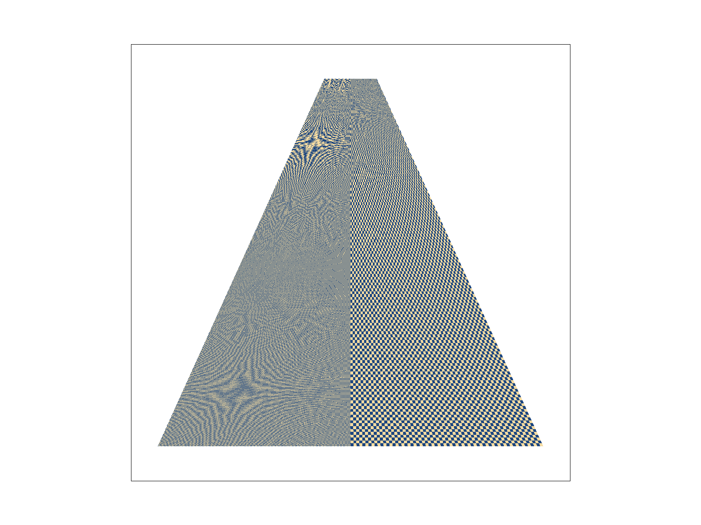 | 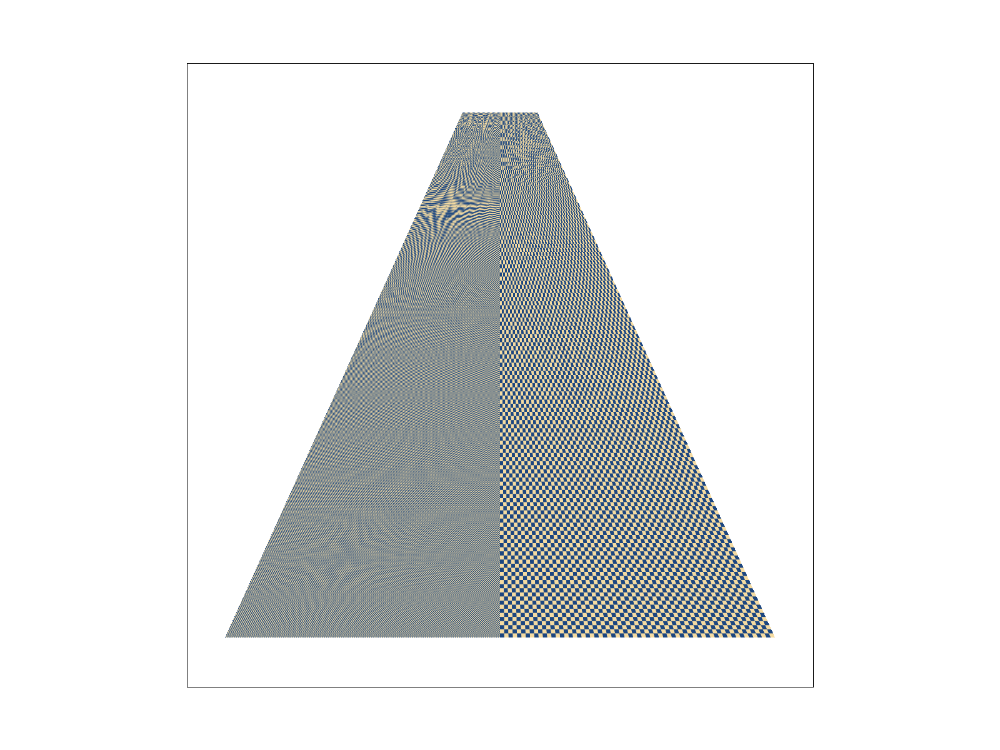 |
| 最近层级 | 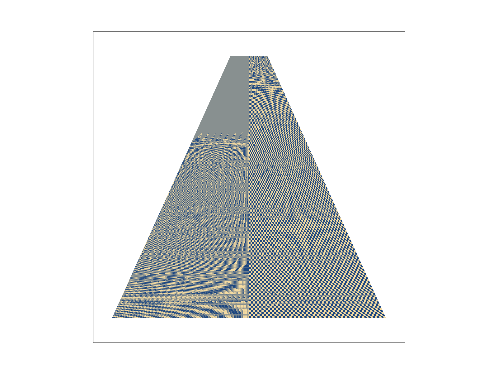 | 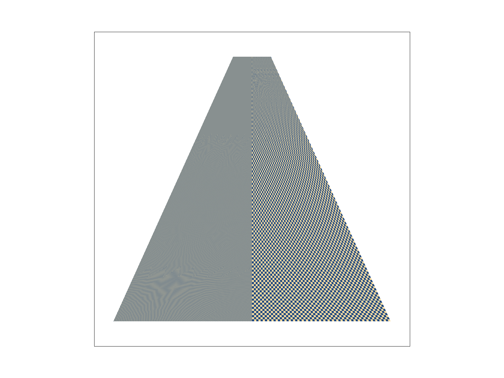 |

固定在原始层并使用最近邻采样时，左半边和上方狭窄区域出现了条纹，这些条纹并不在原图里。改用双线性后，局部颜色跳变减轻，大范围的摩尔纹还在。

按最近层级采样后，远处无法分辨的棋盘格接近蓝黄两色的平均值，条纹减少。配合双线性采样，仍能看清的棋盘边缘也更平滑。整数层级切换的位置还有突变，左侧从均匀颜色变成棋盘纹理的交界比较明显。不同三角形的 UV 梯度有差异，这条交界也呈现出锯齿形。

保持相同视角和采样次数，改用层级插值后得到下面的结果。

| 层级插值与最近邻采样 | 层级插值与双线性采样 |
| --- | --- |
| 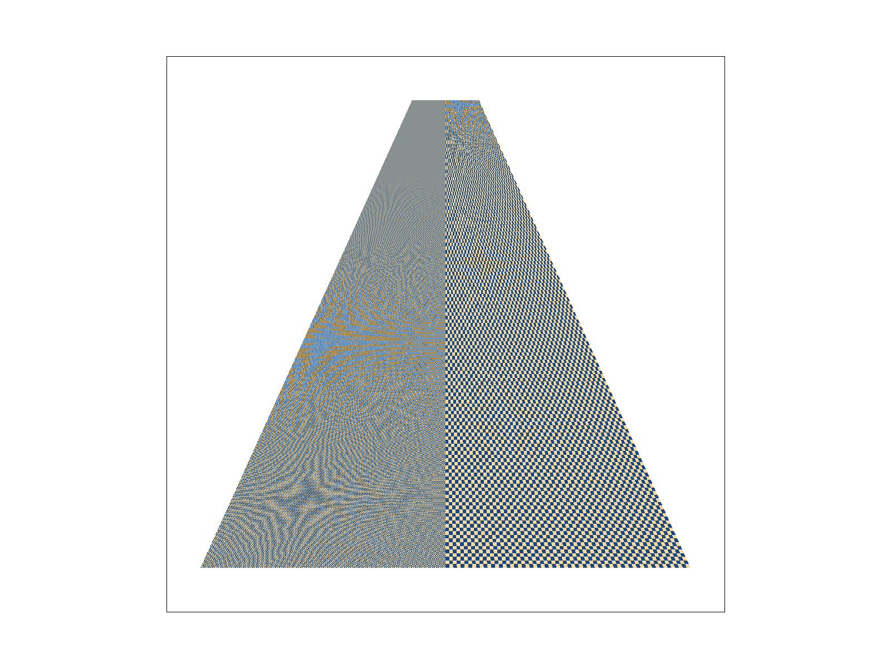 | 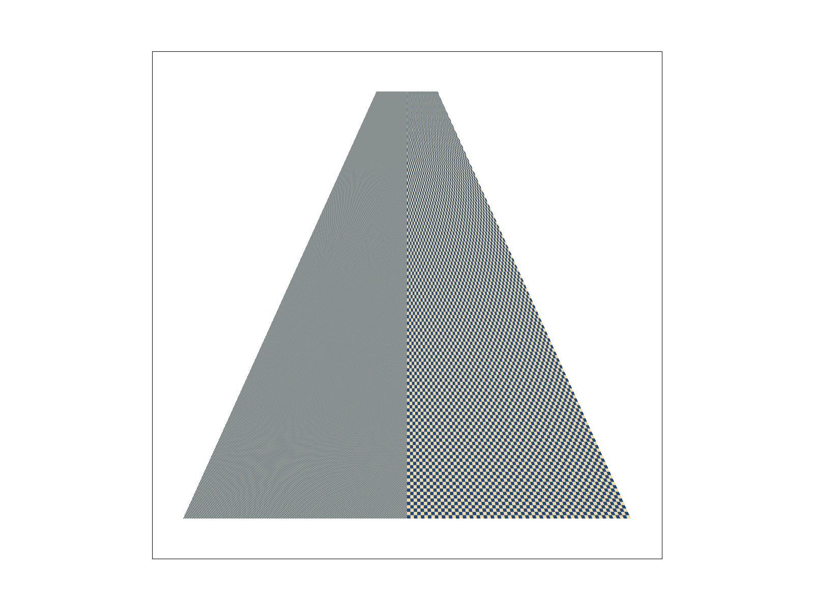 |

层级之间插值后，清晰度变化不再那么突然。三线性滤波还会平滑层内的纹素边界。这个高频例子里仍有走样，网格中各三角形的梯度差异也没有全部消失。

下面比较每个屏幕采样点需要读取的纹素数量。这是算法工作量，没有做运行时间测量。

| 层级采样 | 最近邻像素采样 | 双线性像素采样 |
| --- | --- | --- |
| 固定原始层 | 1 | 4 |
| 最近层级 | 1 | 4 |
| 层级插值 | 2 | 8 |

开启每像素 $S$ 次超采样后，表中的读取次数还要乘以 $S$。双线性改善放大后的色块，MipMap 用预过滤后的纹理减少缩小走样。三线性同时平滑纹素边界和层级切换，读取次数也最多。超采样还能处理三角形的部分覆盖，MipMap 本身不能解决几何边缘的锯齿。

对于宽、高都逐级减半的正方形纹理，完整 MipMap 链的存储量约为原图的 $1+1/4+1/16+\cdots=4/3$，多出约三分之一。模板在加载纹理时就分配了这些层级，切换层级采样方式不会改变已分配的纹理内存。

## 八、实践与思考

写超采样时，我觉得样本的存放方式比公式更费心。一个像素从一种颜色变成多个样本后，写入和求平均都要跟着改，点和线也要用同一套布局。我把这些过程放在一起检查，才理顺每个样本写到哪里、最后又怎样变成像素颜色。单独看三角形的绘制，确实容易漏掉其他地方。

选 MipMap 层级时，我还需要分清超采样间距和 UV 差分的距离。两处都在计算邻近位置，很容易觉得应该一起变小。选层估计的是一个输出像素覆盖多少纹素，所以即使像素里取了更多样本，差分仍按一个屏幕像素计算。理清这一点后，我才把覆盖采样和纹理选层分开理解，也知道了公式里的距离到底指什么。

看实验结果时，细三角形的变化最直观。单次采样时尖端有间断，增加采样后，边缘出现浅红色，尖端也连贯了。我能从图里看出，部分覆盖是怎样变成像素颜色的。相比只看最终缩小的整张图，像素检查器里的几个边缘像素更容易让我理解超采样在做什么。

钟楼和棋盘格给我的感受不太一样。双线性让窗框边缘柔和了，缩小后的棋盘格里还是有摩尔纹。看到这里，我才把颜色过渡平滑和采样足够这两件事分开考虑。使用 MipMap 后，棋盘格里的条纹减少了，整数层级切换的位置又出现了清晰度突变。加入层级插值后，这种过渡缓和了一些，网格交界处仍能看出变化。我觉得这组对比比单看某一种方法更有用，既能看到改善，也能看到它还处理不了什么。

MipMap 末层的问题让我印象比较深。原模板已经分配了最后一层，生成时却漏掉了它，里面的纹素仍是零值，纹理缩得足够小时就可能读到黑色。报告里的对比图没有选到这一层，所以这些截图看起来正常，也不能说明所有层都生成好了。我对照分配和生成的范围，补上了最后一层的处理，也修正了从中间层开始生成时的范围。分配了空间和填好了数据是两件事，这次我对这一点有了更具体的认识。

算缓冲区大小时，我发现十六次采样在当前画布上就需要约 352 MiB。边缘确实更平滑，内存的代价也摆在那里。对我来说，这个数字比单说“采样率越高，开销越大”更有感觉。如果继续做，我想先试试分块渲染，每次只保存一小块的样本，再输出到整张图里，希望能在保留当前边缘效果的同时减少内存占用。这部分还没有实现。
