# 计算机图形学课程作业二 网格编辑

姓名 ________　学号 ________

## 一、概述

本次作业实现了贝塞尔曲线和曲面的求值、面积加权顶点法线、边翻转、边分割和 Loop 细分。边分割和细分也支持开放边界。

## 二、贝塞尔曲线和曲面

### 1. 基于 1D de Casteljau 绘制贝塞尔曲线

de Casteljau 算法从控制点出发，对相邻的两个点做线性插值。设控制点为 $P_0,\ldots,P_n$，参数为 $t$，每一层按下面的公式计算。

$$
P_i^{(k+1)}=(1-t)P_i^{(k)}+tP_{i+1}^{(k)},
\qquad P_i^{(0)}=P_i.
$$

每算一层，点数就减少一个。重复计算，直到只剩下一个点，这个点就是参数 $t$ 对应的曲线点。$t=0$ 和 $t=1$ 时，结果分别是首尾两个控制点。

曲线的单步求值遍历点列中的相邻点，将插值结果存入新的点列，每次只计算一层。模板逐层调用这一过程，并保留中间层用于显示，可以据此观察曲线点的计算过程。单层计算的时间复杂度为 $O(n)$，求出一个曲线点需要 $O(n^2)$。

下图是一条三次贝塞尔曲线，参数为 $t=0.5$。白色点和折线是控制多边形，蓝色折线表示中间层，红点是最后得到的曲线点，绿色线条是曲线轨迹。可以看到，每一层都在上一层的相邻点之间取点，最后得到的红点落在绿色曲线上。

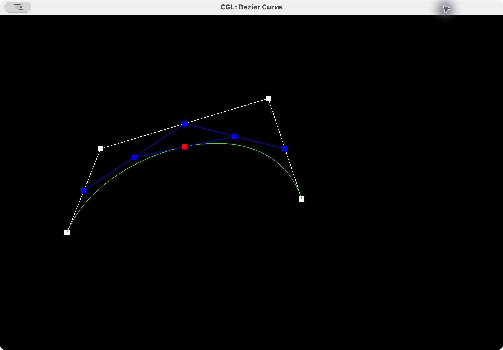

### 2. 基于 1D de Casteljau 绘制贝塞尔曲面

曲面的控制点排成一个二维网格，求值需要两个参数 $u$ 和 $v$。先用参数 $u$ 对每一行求值，再将得到的点组成新的点列，用参数 $v$ 求值。

$$
R_i(u)=\operatorname{deCasteljau}(P_{i,0},\ldots,P_{i,n};u),
$$

$$
S(u,v)=\operatorname{deCasteljau}(R_0(u),\ldots,R_m(u);v).
$$

两个方向都采用一维 de Casteljau 求值，参与插值的是三维点。求值时先复制一份点列，逐层计算到只剩一个点，原始控制点不变。两个方向的计算完成后，就得到了曲面上的一个点。

模板中每块曲面有 $4\times4$ 个控制点，两个方向各采样 16 个区间，再把小四边形拆成三角形，每块曲面生成 512 个三角形。下图的茶壶就是由这些曲面采样后拼成的。图中能看到表面的三角网格，壶嘴和把手的弯曲处也由采样点连接起来。

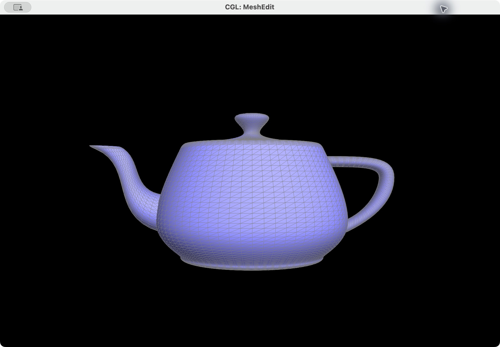

## 三、三角网格和半边数据结构

### 3. 基于面积加权的顶点法线计算

计算一个顶点的法线，需要遍历它周围的三角形。从顶点的一条出半边开始，每次转到对向半边，再沿面走到下一条半边，直到回到起点。表示边界环的虚拟面不参与计算。

对于顶点 $P$ 及相邻三角形 $(P,A_i,B_i)$，先计算两个边向量的叉积。

$$
N_i=(A_i-P)\times(B_i-P).
$$

叉积的方向是面法线方向，长度是三角形面积的两倍。把这些叉积相加，再归一化，就得到了面积加权的单位顶点法线。

$$
\hat N_P=\frac{\sum_i N_i}{\left\|\sum_i N_i\right\|}.
$$

叉积本身已包含面积权重，因此不再额外乘以面积。求和前保留各个叉积的长度，只在最后归一化。叉积顺序与三角形的顶点绕序保持一致，避免法线方向相反。

下面使用同一个三角网格茶壶，只切换着色所用的法线。

| 面法线着色 | 顶点法线着色 |
| --- | --- |
| 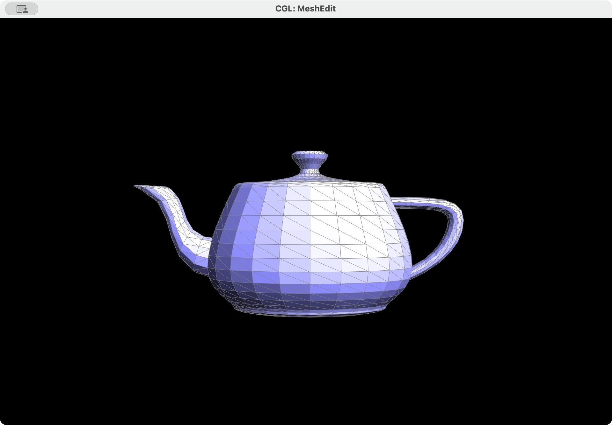 | 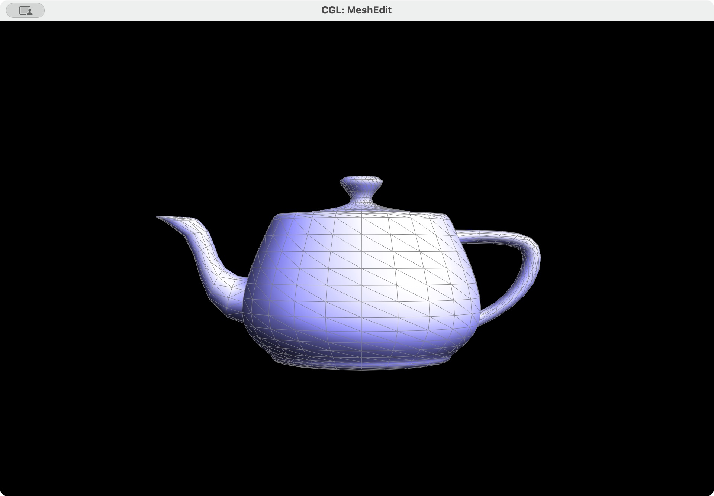 |

左图能看到壶身上的明暗分块。右图中，相邻三角形之间的明暗过渡变得连续，壶嘴和把手看起来更圆滑。两张图的轮廓相同，三角形数量也没有变化。

### 4. 边翻转 Edge Flip

设内部边为 $AB$，两侧的三角形为 $(A,B,C)$ 和 $(B,A,D)$。翻转后，把公共边换成另一条对角线 $CD$，两个三角形变为 $(C,D,B)$ 和 $(D,C,A)$。

边翻转先取出这两个三角形的六条半边，再按翻转后的三角形顺序重连。原来沿 $AB$ 的两条半边改为沿 $CD$，外围四条半边仍与外部的半边配对。每条半边的后继、起点、所属边和面同时更新，最后调整顶点、边和面的半边入口。

翻转只改变连接关系，不移动顶点，也不增删元素，时间复杂度为 $O(1)$。边界边只有一侧的真实三角形，按作业要求保持原样。

下图翻转了茶壶壶身上的一条内部边。画面中央偏左的对角线从向右下倾斜变成了向右上倾斜，周围顶点的位置没有变化。

| 翻转前 | 翻转后 |
| --- | --- |
|  | 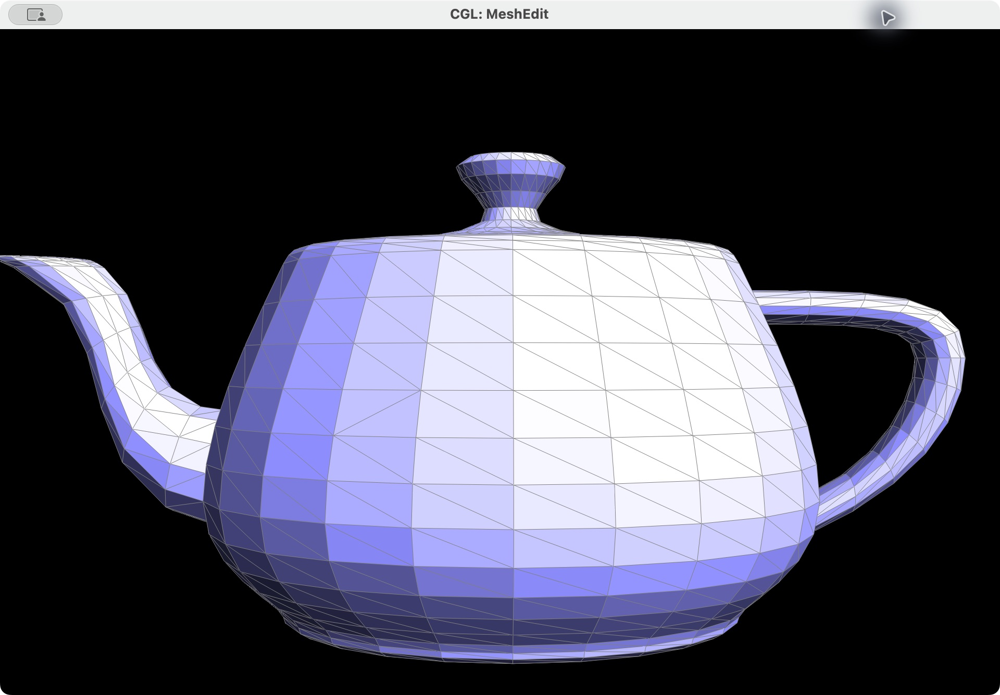 |

### 5. 边分割 Edge Split

分割内部边 $AB$ 时，先在中点插入顶点 $M$。

$$
M=\frac{A+B}{2}.
$$

再把 $M$ 与两侧的对角顶点 $C,D$ 相连。原来的两个三角形就变成了 $(A,M,C)$、$(M,B,C)$、$(M,A,D)$ 和 $(B,M,D)$。

边分割保留原公共边和两个面，创建其余所需元素，再重新连接四个三角形。每个三角形的半边围成闭环，每条边两侧的半边互相配对，顶点、边和面的半边入口也随之更新。新顶点的半边入口沿原边指向一个端点。

分割时还要为 Loop 细分保留标记。沿原边得到的两段记作旧边，从中点连向两侧对角顶点的边记作新边，中点记作新顶点。这些标记用于确定后续需要翻转的边，因此新分配的边不一定标记为新边。

| 分割前 | 分割后 |
| --- | --- |
|  |  |

右图的原对角线上多了一个中点，局部由两个三角形变成四个。已有顶点没有移动，表面的形状也没有改变。

在分割区域左侧继续翻转一条相邻边，得到下面的结果。右图中，中点与外围顶点之间增加了一条边，还出现了一块狭长的深色三角形。这里的几个顶点并不共面，更换对角线后，三角形的形状和明暗也会变化。此次翻转没有让局部网格变得更均匀。

| 组合操作前 | 分割后再翻转相邻边 |
| --- | --- |
|  |  |

边界边分割只把一个真实三角形分成两个，同时在边界环中插入一条半边。保留原边界半边的起点，将新半边接在它后面，可以避免沿整个边界环寻找前驱，操作仍可在 $O(1)$ 时间内完成。

| 操作 | 新增顶点 | 新增边 | 新增真实面 | 新增半边 |
| --- | ---: | ---: | ---: | ---: |
| 内部边分割 | 1 | 3 | 2 | 6 |
| 边界边分割 | 1 | 2 | 1 | 4 |

下面用两个三角形组成的开放正方形观察边界分割。分割上边界后，中点与左下顶点之间多了一条边，三角形从两个变成三个，外轮廓不变。

| 边界边分割前 | 边界边分割后 |
| --- | --- |
| 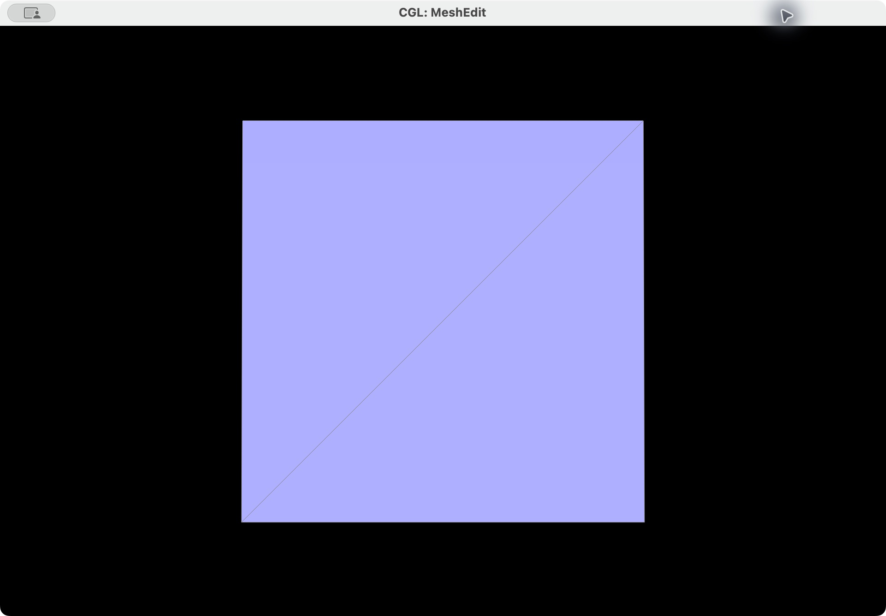 | 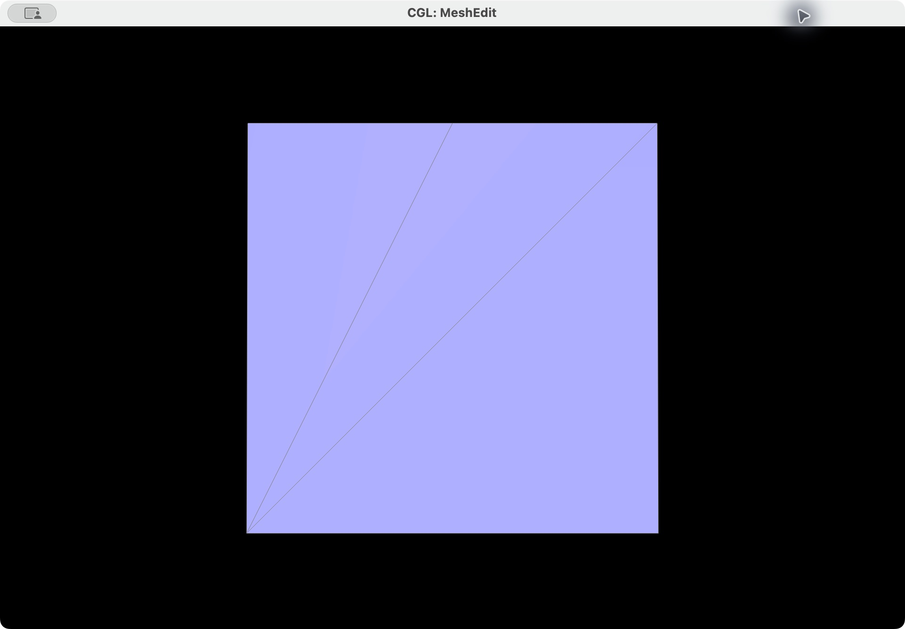 |

### 6. 利用 Loop Subdivision 进行网格上采样

Loop 细分会增加三角形，也会移动顶点。所有新位置都根据这一轮的旧网格计算。如果计算过程中直接移动顶点，后续计算就会读到已经更新的位置，使结果随遍历顺序变化。

设内部旧顶点 $P$ 的度数为 $n$，邻点为 $P_1,\ldots,P_n$，新位置按下面的权重计算。

$$
P'=(1-nu)P+u\sum_{i=1}^{n}P_i,
\qquad
u=\begin{cases}
3/16,&n=3,\\
3/(8n),&n\ne3.
\end{cases}
$$

内部边 $AB$ 两侧的对角顶点为 $C,D$ 时，边上新顶点的位置为

$$
M'=\frac38(A+B)+\frac18(C+D).
$$

边界旧顶点只使用沿边界相邻的两个顶点 $P_-,P_+$。

$$
P'=\frac34P+\frac18(P_-+P_+).
$$

边界边上的新顶点取边中点，不从虚拟边界面寻找对角顶点。

一轮细分按下面的顺序进行。

1. 计算旧顶点的新位置，先保存下来。
2. 计算旧边上新顶点的位置，同时记录本轮的旧边。
3. 分割这些旧边，将预先算好的位置暂存到新顶点上。
4. 只翻转两端分别为新、旧顶点的新边，沿原边分出的两段不翻转。
5. 把保存的位置写回所有顶点。

预先记录旧边，可以将分割范围限定在本轮细分开始时的边。分割后，新顶点暂时位于边的中点，所有顶点的位置在最后一步统一更新。

茶壶经过一次细分后，网格变密，壶盖、壶嘴和把手的折角处过渡更平缓。下面两张图都使用顶点法线。

| 原始茶壶 | 一次 Loop 细分 |
| --- | --- |
| 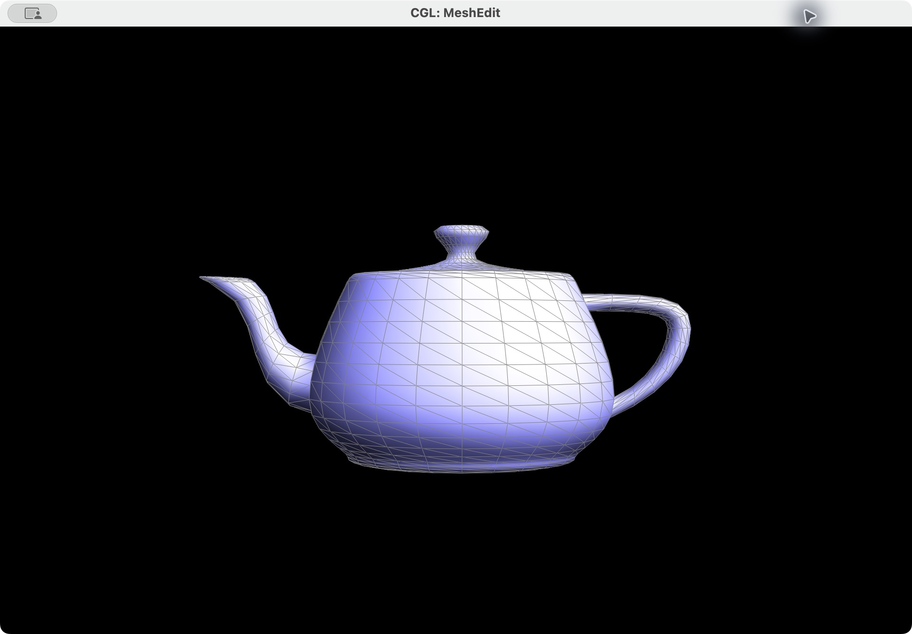 | 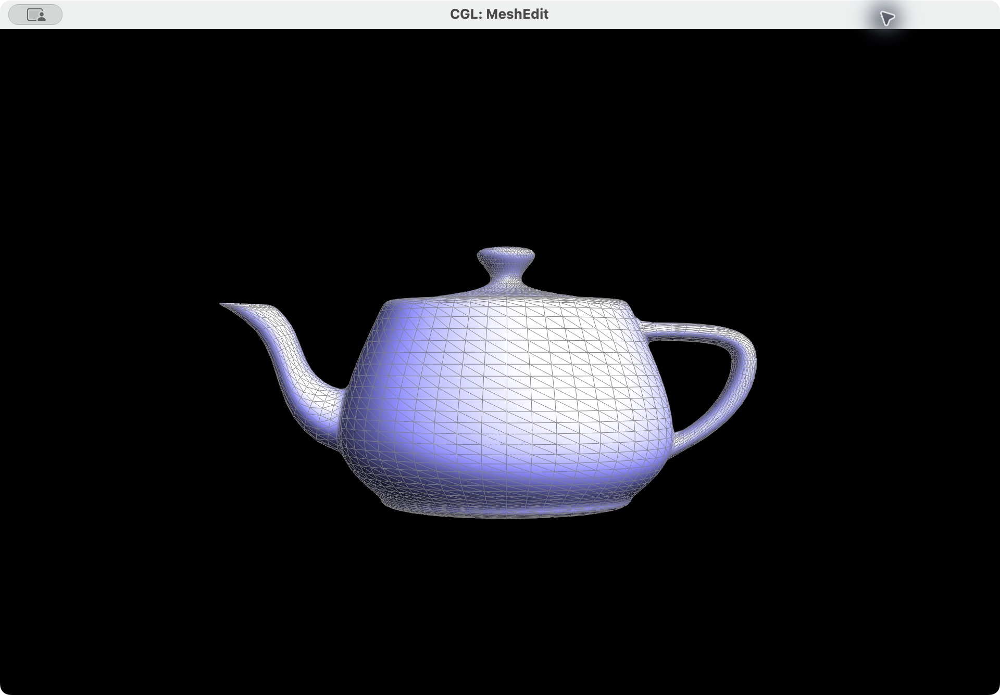 |

开放正方形细分后，四个角向内移动，边界变成八段折线。左图的上边缘由两段倾斜线段组成。先分割上边界再细分，右图上方则保留了一段水平边。两种结果都位于原来的平面上，边界也保持开放。

| 直接细分一次 | 先分割上边界再细分一次 |
| --- | --- |
| 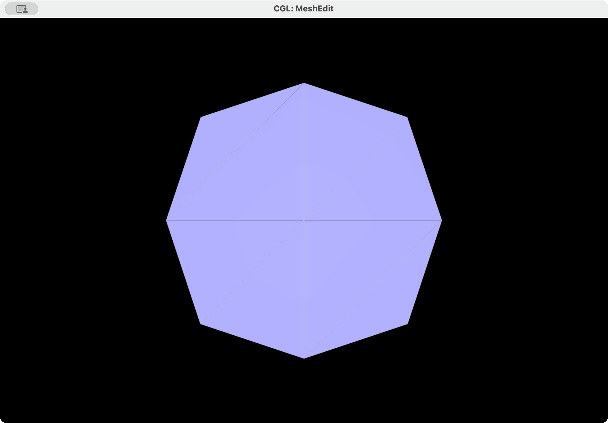 | 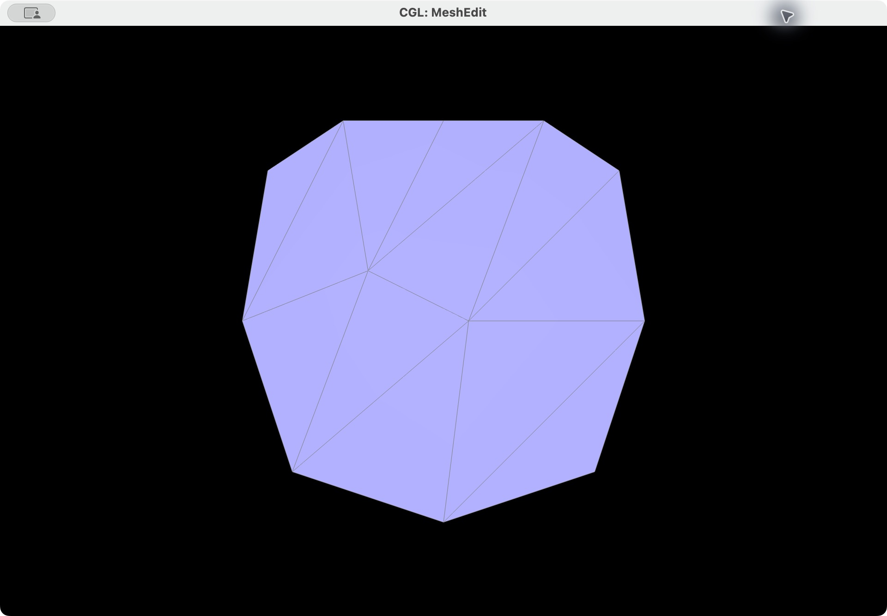 |

预分割改变了上边界附近的顶点分布，使细分后的上边缘更接近原来的直线。原来的两个上角仍会向内移动，预分割并未固定尖角的位置。

#### 立方体的不对称及预处理

原始立方体的每个方形面都被一条对角线分成两个三角形。立方体外形接近对称，但对角线的分布使八个角点的度数从 3 到 6 不等，邻点分布也不同。Loop 细分根据邻点和度数计算新位置，各个角点移动的方向和距离因此出现差别。

预处理分割六条面内对角线，在每个面中心加入一个顶点，并与四个角点相连。每个方形面由四个三角形组成，八个角点的度数都变为 6，面中心的度数为 4，各个角点周围的连接关系也变得对称。

预处理模型还将原来接近 $\pm1$ 的角点坐标取为 $\pm1$，去除约 $10^{-6}$ 量级的坐标误差。下面两组图使用相同视角和着色方式，从上到下是细分零次到三次的结果。

| 细分次数 | 原始立方体 | 预处理后的立方体 |
| --- | --- | --- |
| 0 | 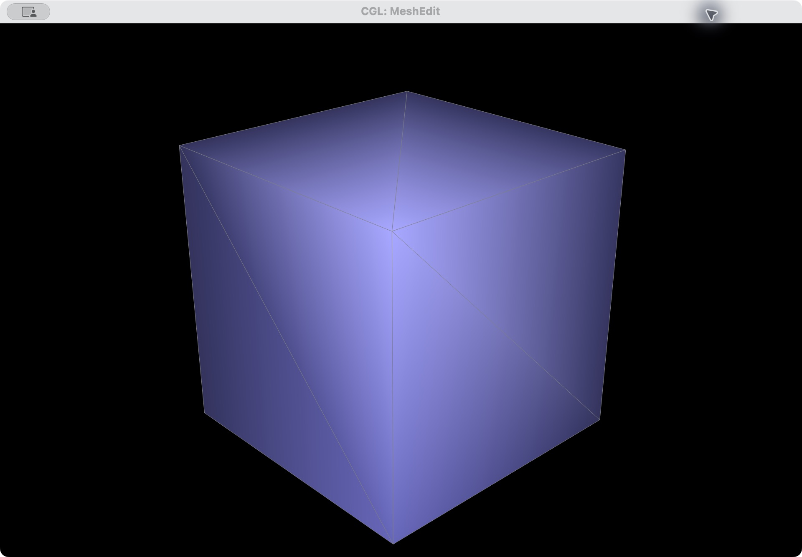 | 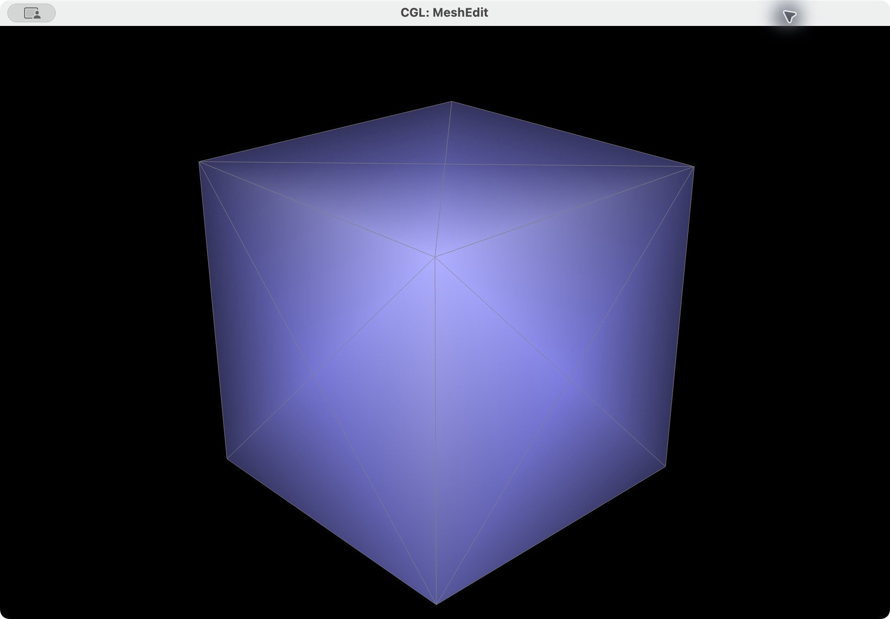 |
| 1 | 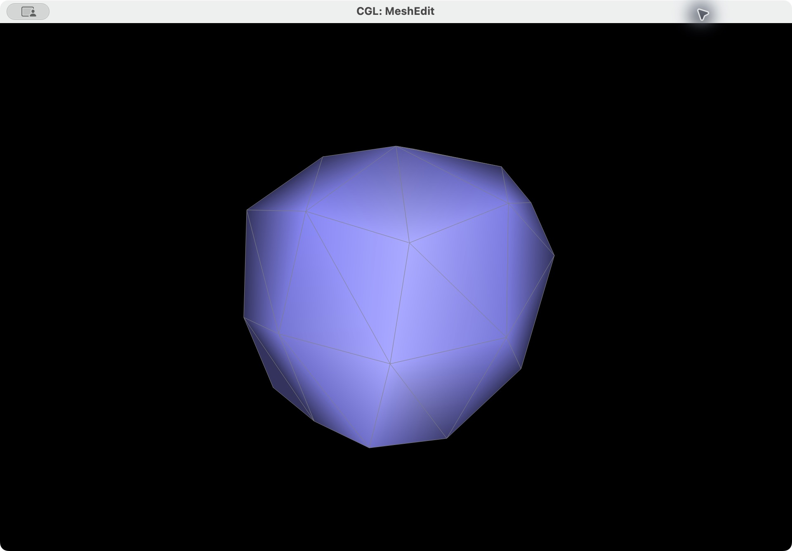 | 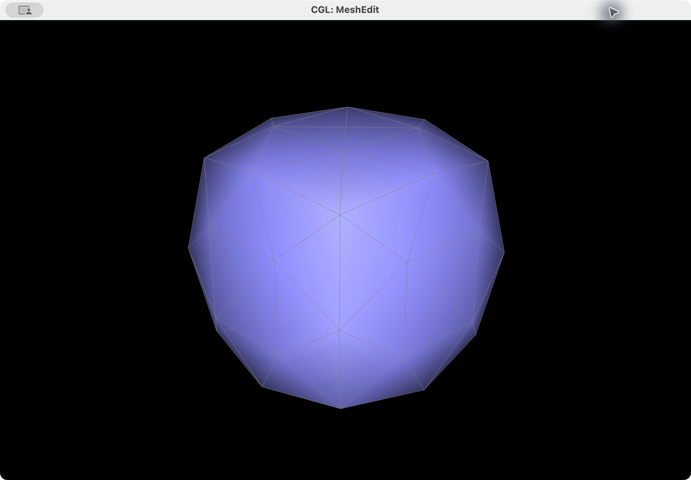 |
| 2 | 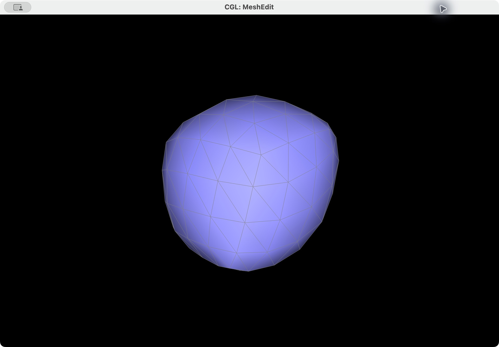 | 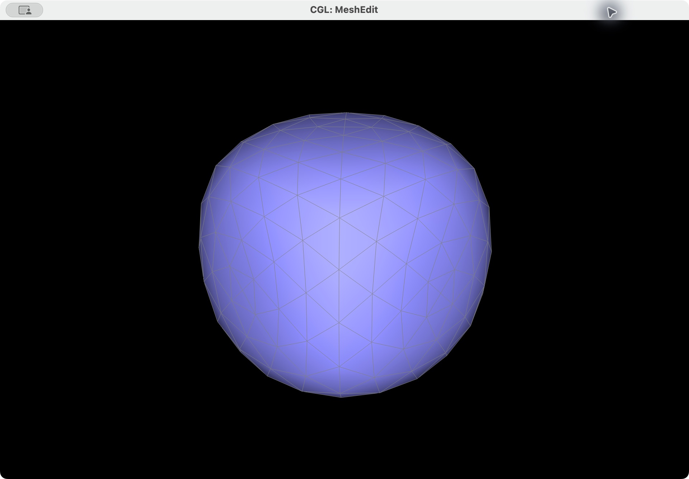 |
| 3 | 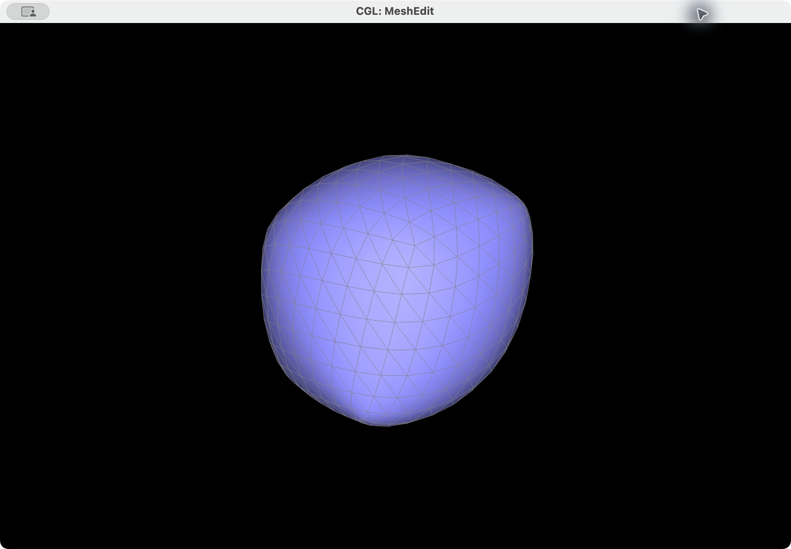 | 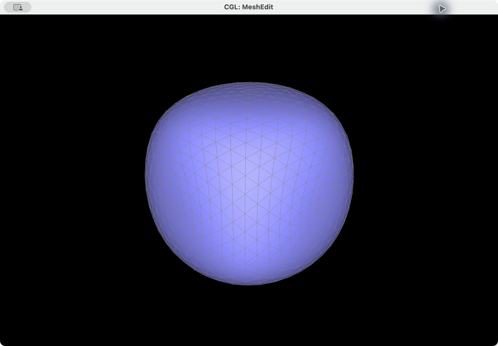 |

原始立方体的尖角很快变圆，继续细分后，两侧的鼓起程度和轮廓不一致。预处理后的立方体也会收缩，两侧轮廓更接近，还能看出圆角立方体的形状。

以预处理后的角点 $(1,1,1)$ 为例，它的六个邻点包括三个相邻角点和三个面中心，位置之和为 $(2,2,2)$。这时 $u=1/16$，第一轮更新得到

$$
P'=\frac58(1,1,1)+\frac1{16}(2,2,2)
=\left(\frac34,\frac34,\frac34\right).
$$

其余七个角点也会移动到对应的对称位置。各个角点的邻域可以通过旋转或镜像互相对应，采用相同的权重计算后，结果也保持对称。

每一轮细分都会把一个三角形分成四个，三角形总数也变为原来的四倍。连续细分后，存储和绘制开销会增加。

## 四、实践与思考

处理半边连接时，需要同时看每个三角形内部的顺序和它与周围网格的关系。局部只有几条边，修改范围不大，但一条半边的后继、配对和所属面都要对应，顶点、边和面的入口也不能漏掉。先按新的三角形逐条重连，再检查外围半边与原网格的连接，思路会清楚一些。截图里出现了新的对角线，还不能说明所有引用都已更新。把这些关系放在一起检查，比只看某一条边更容易发现遗漏。

Loop 细分里的新旧标记也需要分清。沿原边分出的两段中，有一段是新创建的对象，仍然要标记为旧边。如果只按对象的创建时间理解新旧，后续翻边就会选错。这些标记记录的是边在细分中的作用。顶点位置也有类似的先后问题，算出新位置后先保存，等连接关系调整完再统一更新，才能让这一轮计算都使用同一份旧网格。把标记和位置更新的时机理清后，分割、翻转和移动顶点之间的关系也更容易理解。

茶壶的着色对比比较直观。使用顶点法线后，壶身上的明暗分块减轻，壶嘴和把手看起来更圆滑，外轮廓仍是原来的折线。再看细分前后的图，轮廓和表面的三角网格都发生了变化。只看壶身的明暗，两种处理都能让表面显得平滑，沿着壶嘴和把手的边缘看，就更容易分清顶点法线着色和几何细分各自改变了什么。

立方体的结果中，连接关系的影响更明显。原始外形接近对称，细分几次后，两侧的轮廓却出现差别。检查角点邻域可以看到，各个角点的度数和邻点分布并不相同。分割六条面内对角线后，各个角点都有相同的邻域结构，细分结果也保持了对称。两组模型使用同一套权重，变化来自输入网格。这组对比说明，观察细分结果时，除了看顶点坐标，还需要看这些顶点是怎样连接的。

开放正方形的对比则能看出顶点分布对边界形状的影响。直接细分时，四个角向内移动，上边缘变成两段倾斜线段。先分割上边界后，上方保留了一段水平边，更接近原来的直线。预先增加的顶点改变了边界更新时使用的邻点，原来的两个上角仍在移动。因此，预分割可以减轻这里的局部形状变化，但没有固定尖角，也不能据此认为所有边界都能靠增加顶点保持原样。

连续细分后，轮廓更平滑，三角形数量也增长得很快。按每轮面数变为四倍计算，原始立方体的 12 个三角形经过三轮细分就变成了 768 个。这个数量变化比只说细分会增加开销更直观，继续细分时需要考虑模型大小和显示需求。如果要保留锐边，可以增加折痕标记，并使用对应的权重规则，让指定边不再按普通平滑规则更新。这部分还没有实现。
