# 计算机图形学作业三实验报告

姓名 ________　学号 ________

## 一、概述

本次实验在给定模板上完成了一个路径追踪渲染器。从相机发出射线，求出射线与场景的交点，再根据交点处的材质和光照计算像素颜色。场景求交使用 BVH 加速，光照计算包含直接照明和多次反射产生的间接照明，反射表面采用朗伯漫反射材质。实验还实现了 Russian Roulette 和自适应像素采样。

实验使用 Apple M4 Pro、48 GiB 内存和 macOS 15.8.1，程序按 Release 模式编译。计时均使用一个渲染线程，每组运行一次，只记录渲染阶段的时间，不包含场景加载、BVH 构建和图像保存。除自适应采样实验外，各组都使用固定样本数。

## 二、光线生成与场景求交

### 2.1 相机射线与像素采样

每个像素内部随机选取若干采样点，将坐标除以图像宽高，得到归一化图像坐标。相机朝向局部坐标系的负 $z$ 方向，虚拟成像平面位于 $z=-1$。对于图像坐标 $(x,y)$，射线在相机空间中的方向为

$$
\mathbf d_c=\left((2x-1)\tan\frac{\theta_h}{2},(2y-1)\tan\frac{\theta_v}{2},-1\right).
$$

其中 $\theta_h$ 和 $\theta_v$ 是换算成弧度后的水平、垂直视场角。将方向旋转到世界空间并归一化，以相机位置为起点，就得到了一条相机射线。射线的有效范围由相机的近、远裁剪距离确定。

每条射线返回一个 RGB 辐亮度。对同一像素的样本求平均，得到像素颜色。增加样本数可以减轻轮廓锯齿，也能降低光照采样带来的噪声。

### 2.2 三角形与球体求交

三角形求交采用 Möller–Trumbore 算法。设射线起点和方向分别为 $\mathbf o$、$\mathbf d$，三角形顶点为 $\mathbf p_1,\mathbf p_2,\mathbf p_3$，交点满足

$$
\mathbf o+t\mathbf d=\mathbf p_1+u(\mathbf p_2-\mathbf p_1)+v(\mathbf p_3-\mathbf p_1).
$$

通过叉积和点积求出 $t,u,v$。当 $u\geq0$、$v\geq0$、$u+v\leq1$，且 $t$ 位于射线的有效区间内时，交点有效。交点法线按重心权重 $(1-u-v,u,v)$ 对三个顶点法线插值，再做归一化。计算接受三角形的正反两面。

球体求交将射线代入球面方程。令球心为 $\mathbf c$，半径为 $R$，并记 $\mathbf s=\mathbf o-\mathbf c$，则有

$$
a=\mathbf d\cdot\mathbf d,\quad b=\mathbf s\cdot\mathbf d,\quad c=\mathbf s\cdot\mathbf s-R^2,
\qquad t=\frac{-b\pm\sqrt{b^2-ac}}{a}.
$$

判别式小于零时没有交点。有两个根时先检查较小的根，如果它早于射线的有效起点，再检查较大的根。这样也能处理射线从球内出发的情况。球面法线由球心指向交点，长度归一化为 1。

每次找到有效交点，都把射线的最远距离缩短到这个位置。后续求交只考虑更近的图元，最终留下沿射线最近的交点。

### 2.3 法线显示结果

求交结果用法线颜色显示，先将法线映射为 $0.5\mathbf n+0.5$，再经过输出时的曝光和伽马变换，得到图中的颜色。这组对照只显示几何信息，不计算光照。

| 场景 | 法线图 |
| --- | --- |
| 空房间，包含三角形墙面 | 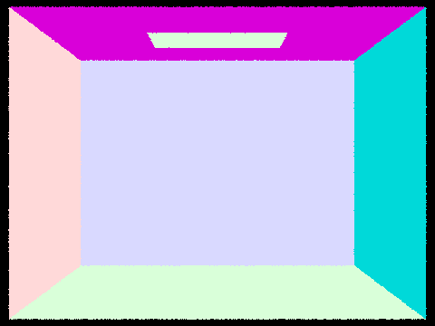 |
| 球体房间，包含墙面和两个球体 | 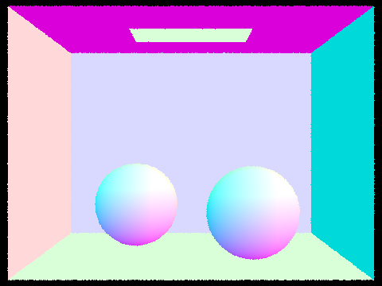 |

墙面内部的颜色一致，球体表面的颜色连续变化。图中轮廓还有些锯齿，这组图每个像素只取了一个样本。

## 三、空间加速数据结构

### 3.1 BVH 构建与遍历

BVH 的每个节点保存一个包围盒。先合并当前图元的包围盒，再统计这些包围盒中心点在三个坐标轴上的分布。选择跨度最大的轴，按中心坐标的中位数把图元分成两组，分别构建左右子树。图元数量不超过 4 时停止划分，建立叶节点。

按中位数划分可以让左右两组的图元数量接近。即使中心点重合，也不会把所有图元分到同一边。构建的平均时间复杂度约为 $O(N\log N)$，查询效率则和节点包围盒的重叠情况有关。

包围盒求交采用 Slab 方法，分别计算射线穿过三个轴向区间的时间，再取公共区间。公共区间为空，射线就没有穿过包围盒。如果射线平行于某一组平板，则检查起点是否位于这组平板之间。

遍历时先检查节点的包围盒。射线没有命中，就跳过这个节点下的所有图元。到达叶节点后才逐个求交。阴影查询找到一个遮挡物就可以结束，最近交点查询则要检查两个子节点，不能因为一边命中就提前返回。

### 3.2 较大模型的求交结果

| 模型 | 图元数量 | 法线图 |
| --- | ---: | --- |
| 奶牛 | 5,856 | 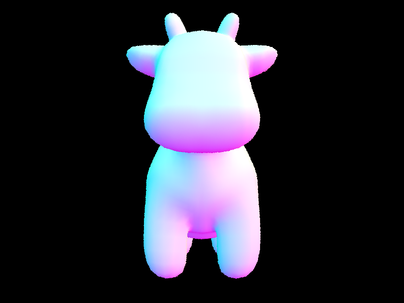 |
| Max Planck | 50,801 | 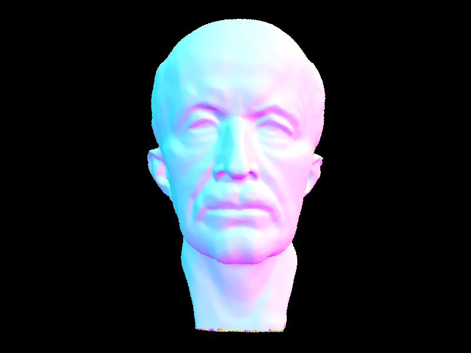 |
| Lucy | 133,796 | 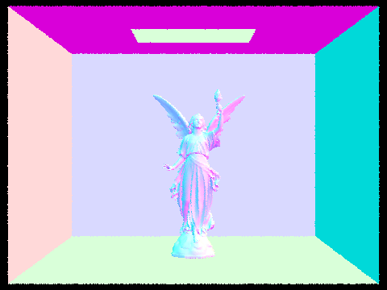 |

奶牛和 Max Planck 的展示分辨率为 800×600，Lucy 为 480×360。Max Planck 的鼻梁、眼眶和嘴部有连续的颜色变化，Lucy 的手臂和翅膀边缘仍能看到单次采样留下的锯齿。

### 3.3 运行时间对比

计时选用奶牛模型，分辨率固定为 320×240，每个像素取一个样本，使用法线着色。对照组把所有图元放在同一个叶节点中，保留最外层包围盒检查，命中后遍历全部图元。两组使用相同的采样和三角形求交方法。

| 设置 | 渲染时间 / 秒 | 射线数 | 每条射线平均图元求交次数 |
| --- | ---: | ---: | ---: |
| 单叶节点，逐图元求交 | 1.1138 | 76,800 | 5856.000 |
| BVH | 0.0261 | 76,800 | 11.338 |

这次运行中，使用 BVH 后的渲染速度约为对照组的 42.7 倍，每条射线平均检查的图元从 5856 个降到约 11.34 个。BVH 构建用了 0.0016 秒，这部分时间没有计入表中的渲染耗时。

## 四、直接光照

### 4.1 光照计算与采样方法

直接光照计算光源经过一次表面反射后到达相机的光。相机直接看见光源时，取光源自身的发光值，这部分属于零次反弹。

朗伯漫反射的 BRDF 为 $f_r=\rho/\pi$，其中 $\rho$ 是 RGB 反射率。对入射方向采样后，直接光照的蒙特卡洛估计为

$$
L_d\approx\frac1N\sum_{i=1}^{N}\frac{f_r(\omega_o,\omega_i)L_i(\omega_i)\cos\theta_i}{p(\omega_i)}.
$$

在交点处建立局部坐标系，以表面法线为 $z$ 轴。BRDF 和余弦项在局部空间计算，射线求交使用世界坐标。

均匀半球采样在表面上方随机选取方向，概率密度为 $1/(2\pi)$。沿这些方向发出射线，如果最近交点是发光表面，就把它的贡献计入结果。没有命中光源的样本贡献为零。

重要性采样改为在光源上选取样本，再检查交点到光源之间有没有遮挡。面积光源使用设定数量的样本，点光源只需采样一次。表面背面的方向不计入反射。阴影射线从交点附近开始，在到达光源前结束，避免把出发点或光源本身当作遮挡物。

面积光源还需要把面积上的概率密度换算成立体角密度，换算后有 $p_\omega=r^2/(A|\cos\theta_L|)$。其中 $r$ 是到光源样本的距离，$A$ 是光源面积，$\theta_L$ 是连线与光源法线的夹角。模板计算时使用了未归一化的方向，少了一个距离因子，积分前补上了这个因子。

### 4.2 两种采样方法的结果

以下图像使用同一个兔子场景，分辨率为 480×360，每像素 64 个样本，每个面积光源 8 个样本，只计算一次反弹。

| 采样方式 | 渲染结果 |
| --- | --- |
| 均匀半球采样 | 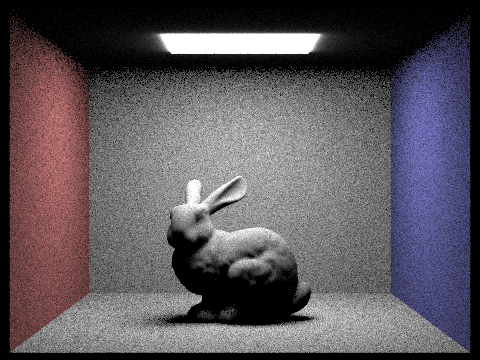 |
| 光源重要性采样 | 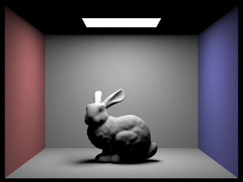 |

均匀半球采样用了 33.9235 秒，重要性采样用了 25.7984 秒。前一张图的墙面和地面上有较多颗粒，后一张图的亮度变化更平滑。半球采样有不少方向没有命中光源，这些样本也就没有光照贡献。直接在光源上采样，能把更多计算用在有贡献的方向上。

光源附近的光晕也有差别。半球方法直接读取发光表面的辐亮度，面积光源采样还考虑了发光方向，两者对光源背面的处理不同，所以这部分差异不全是噪声。

### 4.3 采样数量的影响

仍使用 480×360 的兔子场景和一次反弹，分别增加像素样本数与光源样本数。

| 每像素样本数 / 每光源样本数 | 渲染结果 |
| --- | --- |
| 8 / 1 | 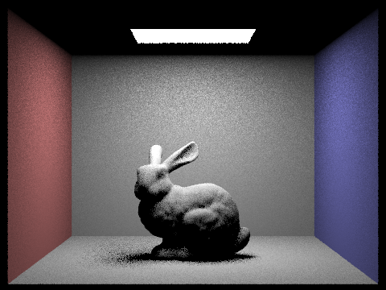 |
| 64 / 1 |  |
| 64 / 8 |  |

| 每像素样本数 / 每光源样本数 | 渲染时间 / 秒 |
| --- | ---: |
| 8 / 1 | 0.7139 |
| 64 / 1 | 5.5822 |
| 64 / 8 | 25.7984 |

像素样本从 8 个增加到 64 个后，墙面和兔子表面的颗粒减少。保持 64 个像素样本，再把光源样本从 1 个增加到 8 个，地面软阴影边缘的颗粒继续减少。光源样本增多，阴影查询次数也增加，渲染时间从 5.5822 秒增加到 25.7984 秒。

## 五、全局光照

### 5.1 多次反射的计算

直接光照只考虑光源照到表面的部分。表面接收到光后还会向周围反射，这些光可以照亮其他物体，也可以经过多次反射后到达相机。全局光照把这部分间接照明纳入计算。

计算累积光照时，每个交点先计算直接光照，再按材质采样一个方向，发出射线寻找下一个交点，递归计算那里的反射光。朗伯材质采用余弦加权半球采样，概率密度为 $p(\omega)=\cos\theta/\pi$，相应的传输权重为

$$
\frac{f_r(\omega_o,\omega_i)\cos\theta_i}{p(\omega_i)}=\rho.
$$

累积模式把各次反弹的贡献相加，相机可见的自发光项另行加入。直接光照已在每个交点估计，递归时不再重复加入下一交点的自发光项。每次反弹后，剩余深度减一，到达设定次数就停止。

### 5.2 不同采样数量下的结果

兔子场景的分辨率为 480×360，每个光源取 4 个样本，最多计算 5 次反弹。

| 每像素样本数 | 全局光照结果 |
| --- | --- |
| 8 |  |
| 128 | 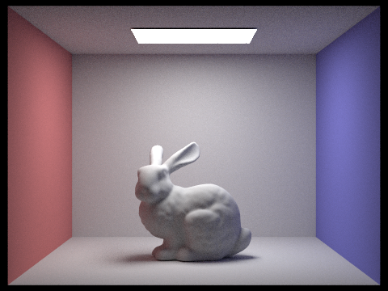 |

8 个样本用了 6.1887 秒，128 个样本用了 100.4127 秒。低样本图中，顶面、地面和兔子背光侧的颗粒较多。增加到 128 个样本后，这些区域的亮度变化更连续，也能看清红蓝墙面带来的颜色变化。图中还有一些噪声，没有再做降噪处理。

球体场景也使用 480×360、128 个像素样本、4 个光源样本和最多 5 次反弹。左侧球体靠近红墙的部分偏红，右侧球体和地面上能看到蓝墙的影响。

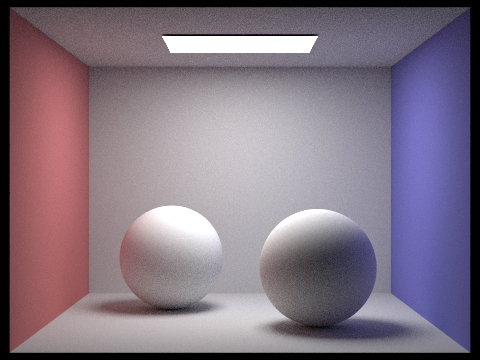

### 5.3 与直接光照的对比

两张对照图都使用 320×240 分辨率、64 个像素样本和 4 个光源样本，只改变最大反弹次数。

| 光照设置 | 渲染结果 |
| --- | --- |
| 直接光照，最多 1 次反弹 | 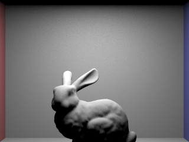 |
| 全局光照，最多 5 次反弹 | 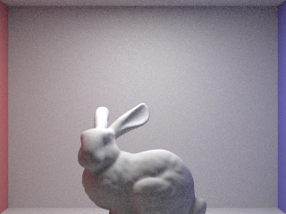 |

直接光照下，兔子的胸前和躯干左侧较暗。这些位置接收到的直射光较少。加入间接照明后，墙面和地面的反射光照亮了这些部位，靠近红墙的一侧也带上了红色。两组使用相同的样本数，全局光照图中的颗粒仍比直接光照图多。

### 5.4 各次反弹的贡献

非累积模式只显示指定次数的反射光。表中 1 到 3 次反弹使用这一模式，零次反弹只保留相机可见的自发光。以下图像均为 320×240，每像素 64 个样本，每个光源 4 个样本。

| 反弹次数 | 该阶贡献 |
| --- | --- |
| 0 次，仅保留可见光源的自发光 | 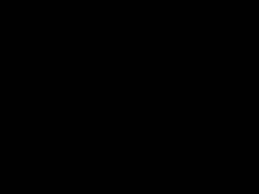 |
| 1 次，直接光照 |  |
| 2 次，包含一次间接传输 | 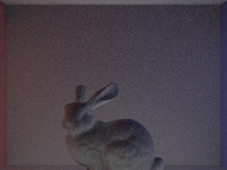 |
| 3 次，包含两次间接传输 | 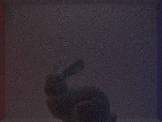 |

这组视角没有把顶部光源收入画面，零次反弹图因此是全黑的。从第 1 次到第 3 次反弹，图像逐渐变暗，红蓝墙面的颜色开始出现在兔子表面。这里每张图只保留一个阶数，没有叠加前面几次的贡献，不能把它们当成累积到该次数的完整图像。

### 5.5 Russian Roulette

光经过多次反射后，贡献通常会减小，继续追踪每条路径需要花费计算时间。Russian Roulette 用随机终止来减少这部分计算。允许多次反弹时，第一个间接方向一定采样，后续每次以 0.65 的概率继续，以 0.35 的概率停止。保留下来的贡献除以 0.65，补偿随机终止的影响。当前交点的直接光照先计算，随机终止只作用于后续的间接部分。

对照组把继续追踪的概率设为 1，其他设置相同。两组分辨率均为 320×240，使用 64 个像素样本、4 个光源样本和最多 5 次反弹。

| 设置 | 渲染结果 |
| --- | --- |
| 启用 Russian Roulette |  |
| 关闭 Russian Roulette |  |

| 设置 | 渲染时间 / 秒 | 射线数 |
| --- | ---: | ---: |
| 启用，后续存活概率为 0.65 | 25.1369 | 65,987,060 |
| 关闭，存活概率为 1 | 35.5430 | 91,226,945 |

启用后，耗时减少约 29.3%，射线数量减少约 27.7%。两张图的明暗和颜色分布接近，颗粒位置不同。被保留路径的权重增大，深层贡献的估计也会有更大波动。

概率补偿使给定深度内的估计保持相同的期望。实验仍以 5 次反弹为上限，超过这个深度的光没有计算，因此还存在截断误差。

## 六、额外工作

额外部分实现了自适应像素采样。每个像素采样时，用 Welford 方法更新亮度均值和离差平方和。每完成一批样本，就用近似 95% 置信区间判断是否继续采样，区间半宽为

$$
I=1.96\sqrt{\frac{s^2}{n}},\qquad s^2=\frac{M_2}{n-1}.
$$

当区间半宽不超过亮度均值与容差的乘积时，这个像素提前结束采样。最终颜色按实际样本数求平均。

实验使用兔子场景，分辨率为 320×240，每像素最多 128 个样本，每个光源 4 个样本，最多 5 次反弹。每批取 32 个样本，容差为 0.05。

| 输出 | 图像 |
| --- | --- |
| 自适应采样结果 |  |
| 像素采样率 | 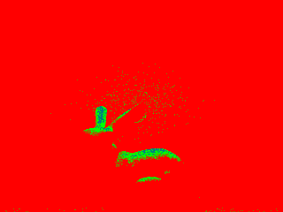 |

采样率图中，蓝色表示样本少，绿色居中，红色表示达到了上限。这次渲染用了 49.0007 秒，平均每像素 126.75 个样本，约为上限的 99.02%，有 2.42% 的像素提前停止。图中大部分区域还是红色，这些像素没有达到设定的停止条件，节省的样本不多。

## 七、实践与思考

处理射线求交时，需要分清交点是否存在，以及这个交点能不能用于当前计算。球体可能有两个交点，较近的根也可能位于射线起点后方。阴影射线还要限制在交点与光源之间，超过光源的物体不应算作遮挡。求交公式本身不长，把这些射线的有效范围放在一起看，才更容易分清哪些交点应该保留。法线图可以检查表面方向，阴影是否正确还要结合射线范围判断。

奶牛的 BVH 对照中，两张图的像素相同，求交次数和耗时却有很大差别。两组都发出了 76,800 条射线，逐图元查询时，每条射线平均检查 5856 个图元，加入 BVH 后只需约 11.34 个。射线没有穿过的包围盒，其内部图元不必再逐个检查，采样数和求交公式都没有改变。看这组结果时，单靠图像无法判断加速效果，还需要对照运行记录。后续可以尝试先访问进入时间较早的子节点，让最近交点更早缩短射线范围，这部分尚未实现。

两种直接光照采样的差别在墙面和地面上比较直观。每像素都是 64 个样本、每光源都是 8 个样本，均匀半球采样仍有较多颗粒，光源重要性采样已经平滑了不少。样本数相同，不代表落在光源上的样本数也相同。半球中许多方向没有命中光源，它们对直接光照的贡献为零。采样分布变了，积分权重也要跟着变。对每个样本除以对应的概率密度，才能把两种采样都用于同一个光照积分。

兔子的光照对比能看出间接照明补在了哪里。直接光照下，胸前和躯干左侧接近黑色，加入多次反射后，这些部位有了亮度，靠近红墙的一侧也偏红。球体场景中的红色和蓝色更容易辨认，场景材质没有改变，变化来自墙面反射过来的光。再把第 1、2、3 次反弹分开看，后两次的图像变暗，墙面的颜色却更突出。相比只看最终累积图，这几张单阶图更容易看出光经过多次反射后怎样衰减，又怎样影响其他表面的颜色。

Russian Roulette 的对照中，最大反弹次数仍然是 5，减少的是继续追踪的路径数量。启用后，渲染时间从 35.5430 秒降到 25.1369 秒，图中的照明分布接近，颗粒位置发生了变化。这里需要同时看终止概率和保留路径的权重。随机丢掉一部分路径后，剩下的贡献要除以存活概率，才能使这一深度范围内的平均贡献保持不变。两张图看起来接近还不能证明估计无偏，概率补偿需要从计算式判断，最大深度以外的光也仍然没有计入。

自适应采样的结果没有出现大面积提前停止。采样率图中大部分区域是红色，只有 2.42% 的像素提前结束，平均每像素仍用了 126.75 个样本，接近 128 个样本的上限。按样本数计算，减少的量不到 1%。停止条件还依赖已经取到的亮度，如果早期没有采到少量高贡献路径，估计的方差可能偏小，像素就会过早停止。因此，采样率图能说明计算量怎样分布，判断图像质量时仍要检查暗部和阴影中的噪声。
